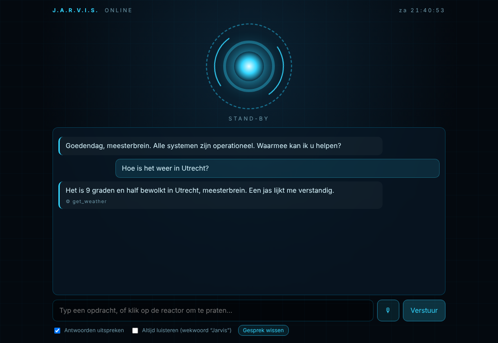

# J.A.R.V.I.S.

*Just A Rather Very Intelligent System*: een persoonlijke AI-assistent die je kunt typen of tegen kunt praten. Hij werkt op Claude (`claude-opus-5-5`) en gebruikt tools, geheugen en webzoeken.



## Wat JARVIS kan

| Vaardigheid | Voorbeeld |
|---|---|
| Gesprek met karakter | "Jarvis, hoe gaat het?" (beleefd, droog en geestig, als een butler) |
| Web zoeken | "Wat is het laatste nieuws over de ruimtevaart?" |
| Weer | "Wordt het morgen regenachtig in Utrecht?" (Open-Meteo, geen sleutel nodig) |
| Tijd en tijdzones | "Hoe laat is het nu in Tokio?" |
| Rekenen | "Wat is 17% van 2340?" (een veilige rekenmachine, nooit uit het hoofd) |
| Geheugen | "Onthoud dat mijn moeder op 12 maart jarig is." (blijft bewaard tussen sessies) |
| Notities | "Noteer dat het wifi-wachtwoord op de koelkast hangt." |
| Takenlijst | "Zet 'band oppompen' op mijn takenlijst." / "Wat staat er nog open?" |
| Herinneringen en timers | "Herinner me over 10 minuten aan de pizza." |
| Websites openen | "Open YouTube." |
| Systeemdiagnose | "Systeemstatus?" (CPU, geheugen, schijf, batterij) |
| Shell-commando's (optioneel) | "Hoeveel bestanden staan er in mijn Downloads?" (vraagt eerst om toestemming) |

## Installatie

```bash
git clone <deze repo> && cd Xander1234yy
python -m venv .venv && source .venv/bin/activate   # Windows: .venv\Scripts\activate
pip install -r requirements.txt
export ANTHROPIC_API_KEY=sk-ant-...                 # Windows: set ANTHROPIC_API_KEY=...
```

Een API-sleutel maak je aan op <https://console.anthropic.com>.

## Starten

```bash
python -m jarvis            # chat in de terminal
python -m jarvis web        # HUD in de browser: http://127.0.0.1:8000
python -m jarvis voice      # spraakmodus via de microfoon (zeg "Jarvis, ...")
python -m jarvis -q "Hoe laat is het?"   # één vraag stellen
```

**Webmodus (aanbevolen):** open de pagina in Chrome of Edge en klik op de reactor om te praten. Vink *Altijd luisteren* aan, dan reageert JARVIS op het wekwoord "Jarvis". Antwoorden worden hardop voorgelezen.

**Spraakmodus in de terminal** heeft extra pakketten nodig:

```bash
pip install -r requirements-voice.txt   # macOS: eerst 'brew install portaudio'
```

## Instellingen (omgevingsvariabelen)

| Variabele | Standaard | Betekenis |
|---|---|---|
| `JARVIS_MODEL` | `claude-opus-5-5` | Claude-model |
| `JARVIS_EFFORT` | `medium` | Denkniveau: `low` (snelst), `medium`, `high`, `xhigh` of `max` |
| `JARVIS_USER_TITLE` | `meesterbrein` | Hoe JARVIS je aanspreekt |
| `JARVIS_LANGUAGE` | `nl` | `nl`, `en`, `de` of `fr` |
| `JARVIS_CITY` | `Amsterdam` | Standaardlocatie voor het weer |
| `JARVIS_WEB_SEARCH` | `1` | Webzoeken aan of uit |
| `JARVIS_ALLOW_SHELL` | `0` | Zet op `1` om shell-commando's toe te staan (met bevestiging in de terminal) |
| `JARVIS_DATA_DIR` | `~/.jarvis` | Waar het geheugen wordt opgeslagen |
| `JARVIS_PORT` | `8000` | Poort van de web-HUD |

## Architectuur

```
jarvis/
├── brain.py      # Claude-agentlus: tools, adaptief denken, webzoeken, refusal-fallback
├── tools.py      # alle vaardigheden + tooldefinities
├── memory.py     # persistent geheugen (feiten, notities, taken, herinneringen)
├── web.py        # HTTP-server + JSON-API (/api/chat, /api/status, /api/reset)
├── voice.py      # microfoon → tekst → JARVIS → spraak
├── static/index.html  # HUD met arc-reactor, spraakherkenning en spraakuitvoer
└── __main__.py   # CLI
```

Een eigen vaardigheid toevoegen: zet een definitie in `TOOL_DEFINITIONS` en schrijf een methode `_t_<naam>` in `ToolBox` (`jarvis/tools.py`).

## Tests

```bash
pip install pytest && python -m pytest
```

## Veiligheid

- De web-HUD luistert standaard alleen op `127.0.0.1`. Zet hem niet open op internet: er zit geen login op.
- Shell-toegang staat standaard uit. In de webmodus worden shell-commando's altijd geweigerd.
