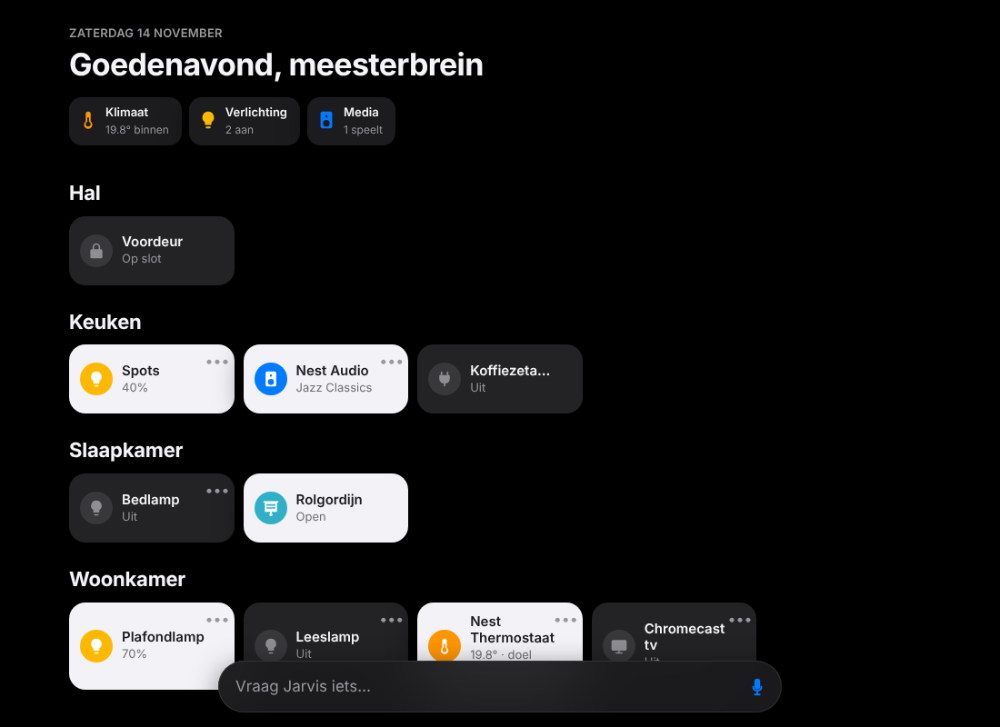

# Jarvis

Je persoonlijke assistent voor thuis. Je typt of praat gewoon, en Jarvis regelt het: je Google Home-apparaten bedienen, het weer opzoeken, herinneringen zetten, op het web zoeken en meer.

<p>
  
  
</p>

## Wat Jarvis kan

- **Google Home bedienen**: "Doe de lampen in de woonkamer uit", "Zet de thermostaat op 21 graden", "Pauzeer de muziek in de keuken", "Zet de slaapkamer op 20 procent warm wit". In de app tik je op een tegel om iets aan of uit te zetten, of op ••• voor helderheid, temperatuur of volume.
- **Vragen beantwoorden** met actuele informatie van het web
- **Weer, tijd en rekenen**
- **Onthouden** wat je vertelt (verjaardagen, voorkeuren), ook na een herstart
- **Notities, takenlijst, herinneringen en timers**
- **Websites openen en je systeem controleren**

## Installatie

```bash
python -m venv .venv && source .venv/bin/activate      # Windows: .venv\Scripts\activate
pip install -r requirements-home.txt                   # inclusief Google Home-ondersteuning
export ANTHROPIC_API_KEY=sk-ant-...                    # Windows: set ANTHROPIC_API_KEY=...
python -m jarvis web                                   # open http://127.0.0.1:8000
```

Een API-sleutel maak je aan op <https://console.anthropic.com>. Tip: open de pagina op je iPhone en kies *Deel → Zet op beginscherm*, dan werkt Jarvis als een app. Je telefoon kan alleen bij Jarvis als je `JARVIS_HOST=0.0.0.0` instelt. Doe dat alleen op je eigen thuisnetwerk.

## Google Home koppelen

Jarvis heeft drie manieren om je huis te bedienen. Je kunt ze combineren.

### 1. Google Assistant: alles uit je Google Home-app (aanbevolen)

Jarvis stuurt je opdracht naar je eigen Google-account, alsof je "Hey Google" zegt. Daardoor werkt alles wat in je Google Home-app staat, van elk merk: kamers, groepen, routines, kleuren, tv's.

1. Ga naar <https://console.cloud.google.com> en maak een nieuw project aan.
2. Zoek bij *API's en services → Bibliotheek* de **Google Assistant API** op en schakel die in.
3. Stel bij *OAuth-toestemmingsscherm* het type *Extern* in, en voeg jezelf toe als **testgebruiker**.
4. Maak bij *Inloggegevens → Inloggegevens maken → OAuth-client-ID* een client van het type **Desktop-app** aan, en download de JSON.
5. Koppel Jarvis:
   ```bash
   python -m jarvis koppel-google ~/Downloads/client_secret_xxx.json
   ```
   Je browser opent; log in met het Google-account dat je Google Home beheert.
6. Zet in de Google Home-app bij je profiel → *Assistent-instellingen* de optie **Persoonlijke resultaten** aan.

### 2. Home Assistant: tegels met live status (optioneel)

Google biedt geen openbare manier om alle apparaten met hun status op te vragen. Wil je in de app tegels per kamer zien met helderheid, temperatuur en wat er speelt? Koppel dan [Home Assistant](https://www.home-assistant.io):

```bash
export HOME_ASSISTANT_URL=http://homeassistant.local:8123
export HOME_ASSISTANT_TOKEN=...   # Profiel → Beveiliging → Langlevend toegangstoken
```

### 3. Nest-speakers en Chromecasts (automatisch)

Speakers, Nest Hubs en Chromecasts op je wifi vindt Jarvis zelf. Je kunt het volume regelen en afspelen, pauzeren of stoppen. Zet het uit met `JARVIS_CAST=0`.

Controleer wat Jarvis ziet met:

```bash
python -m jarvis apparaten
```

## Andere manieren om te starten

```bash
python -m jarvis                      # chat in de terminal
python -m jarvis voice                # spraak via de microfoon (zeg "Jarvis, ...")
python -m jarvis -q "Hoe laat is het?"
```

Voor de spraakmodus in de terminal: `pip install -r requirements-voice.txt` (macOS: eerst `brew install portaudio`). In de web-app tik je gewoon op de microfoon.

## Instellingen

| Variabele | Standaard | Betekenis |
|---|---|---|
| `JARVIS_USER_TITLE` | `meesterbrein` | Hoe Jarvis je aanspreekt |
| `JARVIS_LANGUAGE` | `nl` | `nl`, `en`, `de` of `fr` |
| `JARVIS_CITY` | `Amsterdam` | Standaardlocatie voor het weer |
| `JARVIS_MODEL` | `claude-opus-5-5` | Claude-model |
| `JARVIS_EFFORT` | `medium` | `low` is het snelst, `high` het grondigst |
| `HOME_ASSISTANT_URL` / `_TOKEN` | – | Home Assistant-koppeling |
| `GOOGLE_ASSISTANT_TOKEN` | `~/.jarvis/google_assistant_token.json` | Waar de Google-koppeling staat |
| `JARVIS_CAST` | `1` | Speakers en Chromecasts automatisch zoeken |
| `JARVIS_WEB_SEARCH` | `1` | Webzoeken aan of uit |
| `JARVIS_ALLOW_SHELL` | `0` | Shell-commando's toestaan (met bevestiging in de terminal) |
| `JARVIS_HOST` / `JARVIS_PORT` | `127.0.0.1` / `8000` | Adres van de web-app |

## Voor ontwikkelaars

```
jarvis/
├── brain.py             # Claude met tools, webzoeken en geheugen
├── tools.py             # alle vaardigheden
├── home/                # smart home
│   ├── assistant.py     #   Google Assistant (tekstopdrachten)
│   ├── homeassistant.py #   Home Assistant REST API
│   └── cast.py          #   Google Cast (Nest-speakers, Chromecast)
├── memory.py            # geheugen, notities, taken en herinneringen
├── web.py               # webserver en API
├── voice.py             # spraakmodus
└── static/index.html    # de app
```

Tests: `pip install pytest && python -m pytest`

## Veiligheid

- De web-app heeft geen login. Zet hem nooit open op internet.
- De Google-token geeft toegang tot je Assistent. Hij staat alleen lokaal, met rechten `600`.
