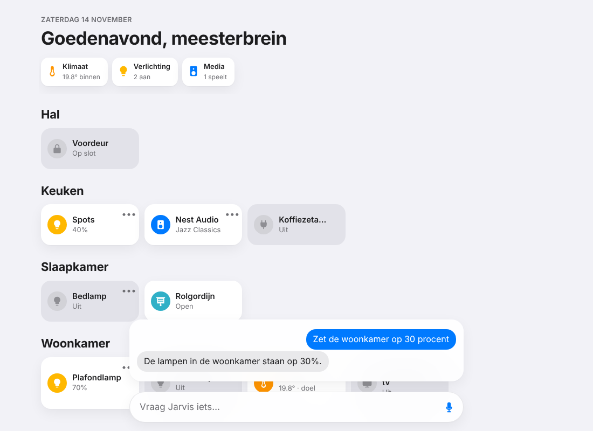
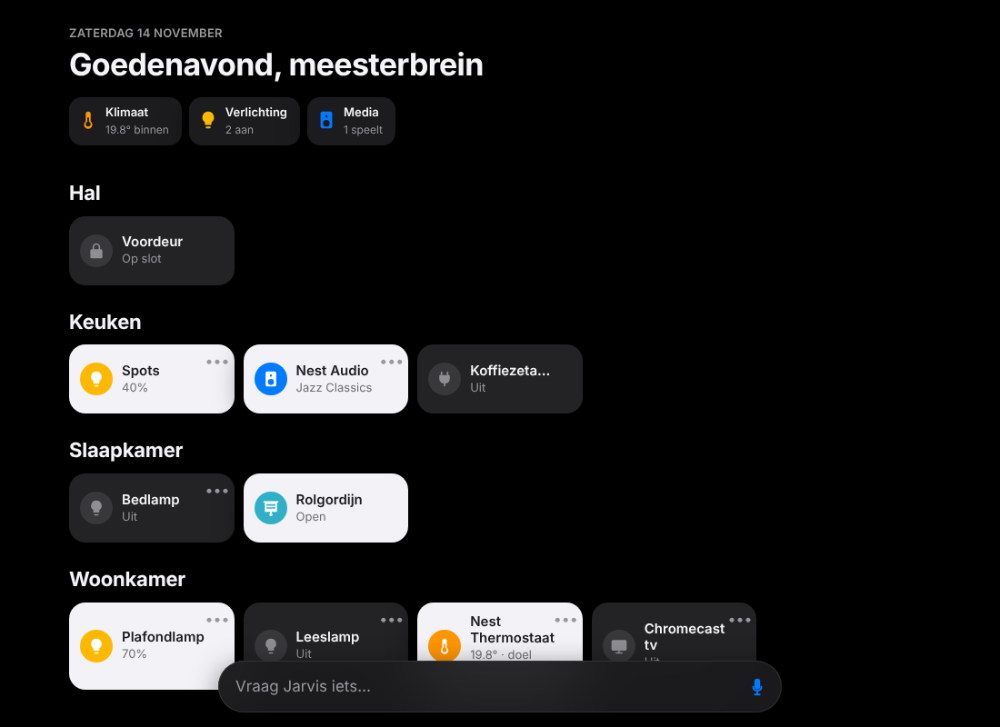
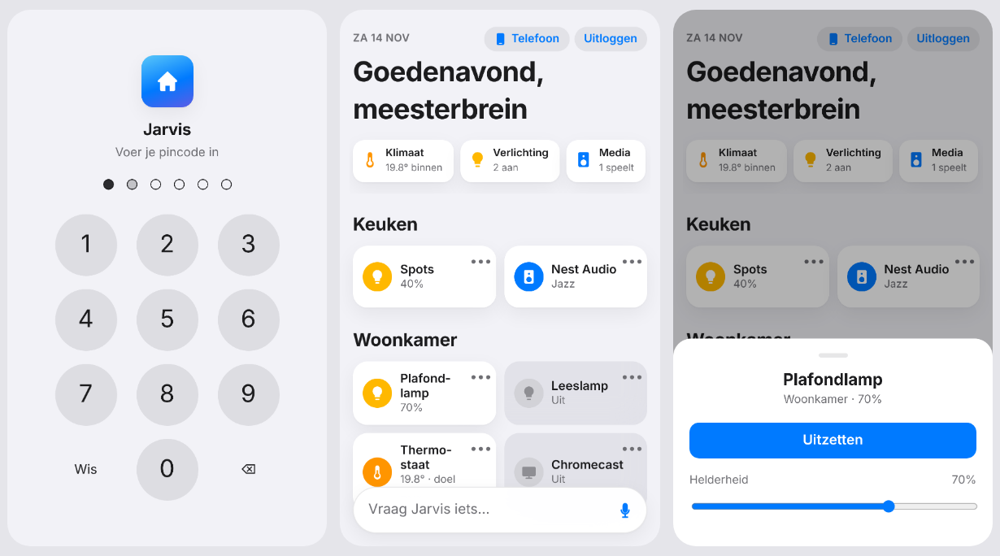

# Jarvis

Je persoonlijke assistent voor thuis. Je typt of praat gewoon, en Jarvis regelt het: je Google Home-apparaten bedienen, het weer opzoeken, herinneringen zetten, op het web zoeken en meer.

<p>
  
  
</p>

## Wat Jarvis kan

- **Google Home bedienen**: "Doe de lampen in de woonkamer uit", "Zet de thermostaat op 21 graden", "Pauzeer de muziek in de keuken", "Zet de slaapkamer op 20 procent warm wit". In de app tik je op een tegel om iets aan of uit te zetten, of op ••• voor helderheid, temperatuur of volume.
- **Vragen beantwoorden** met actuele informatie van het web
- **Weer, tijd en rekenen**
- **Onthouden** wat je vertelt (verjaardagen, voorkeuren), ook na een herstart
- **Notities, takenlijst, herinneringen en timers**
- **Websites openen en je systeem controleren**

## Installatie

```bash
cd jarvis-assistent
python -m venv .venv && source .venv/bin/activate      # Windows: .venv\Scripts\activate
pip install -r requirements-home.txt                   # inclusief Google Home-ondersteuning
export ANTHROPIC_API_KEY=sk-ant-...                    # Windows: set ANTHROPIC_API_KEY=...
python -m jarvis web --telefoon                         # op je computer én telefoon
```

Een API-sleutel maak je aan op <https://console.anthropic.com>.

## Op je telefoon

<p></p>

### Thuis, op hetzelfde wifi

```bash
python -m jarvis web --telefoon
```

Jarvis laat het adres en een pincode zien, bijvoorbeeld `http://192.168.1.23:8000` met code `412168`. Je kunt ook op de computer op **Telefoon** klikken en de QR-code scannen.

1. Open het adres op je telefoon en voer de pincode in. Je blijft een jaar ingelogd.
2. **iPhone:** tik in Safari op *Deel* en dan *Zet op beginscherm*. **Android:** tik in Chrome op het menu ⋮ en dan *App installeren*.
3. Jarvis staat nu als app op je beginscherm, schermvullend, met een eigen icoon.

Wil je zelf een code kiezen? Gebruik `--pin 123456` (4 tot 8 cijfers). Na 5 foute pogingen moet je 5 minuten wachten.

> **Microfoon:** telefoons staan de microfoon alleen toe via een beveiligde verbinding (https). Thuis via `http://` kun je tegels bedienen en typen; om te praten gebruik je de optie hieronder.

### Overal, ook buiten de deur, met microfoon (aanbevolen)

Met [Tailscale](https://tailscale.com) (gratis voor persoonlijk gebruik) krijgt Jarvis een privé https-adres dat alleen jouw apparaten kunnen openen. Dat werkt via 4G, op je werk of op vakantie.

1. Installeer Tailscale op je computer en op je telefoon, en log op beide in met hetzelfde account.
2. Start Jarvis op je computer en deel hem via Tailscale:
   ```bash
   python -m jarvis web --pin 123456
   tailscale serve --bg 8000
   ```
3. Tailscale toont een adres zoals `https://mijn-pc.tailnet-1234.ts.net`. Open dat op je telefoon en zet het op je beginscherm. De microfoon werkt nu ook.

### De telefoonversie op claude.ai, met je echte Google Home

Er is ook een online versie van Jarvis die je zonder installatie op je telefoon opent via claude.ai. Een kopie staat in [`online/jarvis-online.html`](online/jarvis-online.html). Gesprekken, taken, notities, herinneringen en geheugen werken daar meteen. Om ook je echte apparaten te bedienen, koppel je Jarvis thuis één keer als **connector**:

1. Start Jarvis met de connector aan:
   ```bash
   python -m jarvis web --connector
   ```
   Jarvis toont een pincode en een connector-pad zoals `/mcp/AbC123…`. Dat pad is geheim; deel het met niemand.
2. Maak Jarvis bereikbaar via internet met [Tailscale Funnel](https://tailscale.com/kb/1223/funnel):
   ```bash
   tailscale funnel --bg 8000
   ```
   Je krijgt een adres zoals `https://mijn-pc.tailnet-1234.ts.net`.
3. Ga in claude.ai naar *Instellingen → Connectors → Eigen connector toevoegen*. Kies als naam precies **Jarvis**, en als adres het Tailscale-adres plus het connector-pad, bijvoorbeeld `https://mijn-pc.tailnet-1234.ts.net/mcp/AbC123…`.
4. Open de online versie en tik op **Verbind met je huis**. De tegels tonen nu je echte apparaten, en je kunt Jarvis vragen "doe de woonkamer op 30 procent" of "hoe wordt het weer morgen?".

De connector biedt vier tools: `home_devices`, `home_control`, `google_home_command` en `get_weather`. Met `--connector` is de webapp ook via internet bereikbaar. Daarom is de pincode in deze stand altijd verplicht, en zonder het geheime pad geeft de connector alleen "niet gevonden".

### Jarvis altijd aan laten staan

Je telefoon bedient Jarvis via de computer waar hij op draait. Die moet dus aan staan. Een Raspberry Pi of oude laptop is ideaal: gebruik `deploy/jarvis.service` om Jarvis automatisch te laten starten (de stappen staan in het bestand).

Heb je zelf een certificaat (bijvoorbeeld via `tailscale cert`)? Dan kan Jarvis ook zelf https serveren met `JARVIS_CERT=cert.pem JARVIS_KEY=key.pem`.

## Google Home koppelen

Jarvis heeft drie manieren om je huis te bedienen. Je kunt ze combineren.

### 1. Google Assistant: alles uit je Google Home-app (aanbevolen)

Jarvis stuurt je opdracht naar je eigen Google-account, alsof je "Hey Google" zegt. Daardoor werkt alles wat in je Google Home-app staat, van elk merk: kamers, groepen, routines, kleuren, tv's.

1. Ga naar <https://console.cloud.google.com> en maak een nieuw project aan.
2. Zoek bij *API's en services → Bibliotheek* de **Google Assistant API** op en schakel die in.
3. Stel bij *OAuth-toestemmingsscherm* het type *Extern* in, en voeg jezelf toe als **testgebruiker**.
4. Maak bij *Inloggegevens → Inloggegevens maken → OAuth-client-ID* een client van het type **Desktop-app** aan, en download de JSON.
5. Koppel Jarvis:
   ```bash
   python -m jarvis koppel-google ~/Downloads/client_secret_xxx.json
   ```
   Je browser opent; log in met het Google-account dat je Google Home beheert.
6. Zet in de Google Home-app bij je profiel → *Assistent-instellingen* de optie **Persoonlijke resultaten** aan.

### 2. Home Assistant: tegels met live status (optioneel)

Google biedt geen openbare manier om alle apparaten met hun status op te vragen. Wil je in de app tegels per kamer zien met helderheid, temperatuur en wat er speelt? Koppel dan [Home Assistant](https://www.home-assistant.io):

```bash
export HOME_ASSISTANT_URL=http://homeassistant.local:8123
export HOME_ASSISTANT_TOKEN=...   # Profiel → Beveiliging → Langlevend toegangstoken
```

### 3. Nest-speakers en Chromecasts (automatisch)

Speakers, Nest Hubs en Chromecasts op je wifi vindt Jarvis zelf. Je kunt het volume regelen en afspelen, pauzeren of stoppen. Zet het uit met `JARVIS_CAST=0`.

Controleer wat Jarvis ziet met:

```bash
python -m jarvis apparaten
```

## Andere manieren om te starten

```bash
python -m jarvis                      # chat in de terminal
python -m jarvis voice                # spraak via de microfoon (zeg "Jarvis, ...")
python -m jarvis -q "Hoe laat is het?"
```

Voor de spraakmodus in de terminal: `pip install -r requirements-voice.txt` (macOS: eerst `brew install portaudio`). In de web-app tik je gewoon op de microfoon.

## Instellingen

| Variabele | Standaard | Betekenis |
|---|---|---|
| `JARVIS_USER_TITLE` | `meesterbrein` | Hoe Jarvis je aanspreekt |
| `JARVIS_LANGUAGE` | `nl` | `nl`, `en`, `de` of `fr` |
| `JARVIS_CITY` | `Amsterdam` | Standaardlocatie voor het weer |
| `JARVIS_MODEL` | `claude-opus-5-5` | Claude-model |
| `JARVIS_EFFORT` | `medium` | `low` is het snelst, `high` het grondigst |
| `HOME_ASSISTANT_URL` / `_TOKEN` | – | Home Assistant-koppeling |
| `GOOGLE_ASSISTANT_TOKEN` | `~/.jarvis/google_assistant_token.json` | Waar de Google-koppeling staat |
| `JARVIS_CAST` | `1` | Speakers en Chromecasts automatisch zoeken |
| `JARVIS_WEB_SEARCH` | `1` | Webzoeken aan of uit |
| `JARVIS_ALLOW_SHELL` | `0` | Shell-commando's toestaan (met bevestiging in de terminal) |
| `JARVIS_HOST` / `JARVIS_PORT` | `127.0.0.1` / `8000` | Adres van de web-app (`--telefoon` zet de host op `0.0.0.0`) |
| `JARVIS_CONNECTOR` | `0` | Connector voor claude.ai aanzetten (zelfde als `--connector`) |
| `JARVIS_PIN` | automatisch | Pincode voor toegang vanaf andere apparaten (4 tot 8 cijfers) |
| `JARVIS_CERT` / `JARVIS_KEY` | – | Eigen https-certificaat |

## Voor ontwikkelaars

```
jarvis/
├── brain.py             # Claude met tools, webzoeken en geheugen
├── tools.py             # alle vaardigheden
├── home/                # smart home
│   ├── assistant.py     #   Google Assistant (tekstopdrachten)
│   ├── homeassistant.py #   Home Assistant REST API
│   └── cast.py          #   Google Cast (Nest-speakers, Chromecast)
├── memory.py            # geheugen, notities, taken en herinneringen
├── web.py               # webserver en API (http/https)
├── auth.py              # pincode en sessies
├── mcp_server.py        # connector voor claude.ai (MCP)
├── voice.py             # spraakmodus
└── static/              # de app (index.html, manifest, service worker, iconen)
```

Tests: `pip install pytest && python -m pytest`

`online/jarvis-online.html` is de online versie voor claude.ai. Die gebruikt de runtime van claude.ai (Claude, opslag, microfoon en connectors) en werkt dus alleen daar.

## Veiligheid

- Zodra Jarvis bereikbaar is vanaf andere apparaten, is een pincode verplicht. Sessies zijn `HttpOnly`/`SameSite=Strict`-cookies, en na 5 foute pogingen volgt een blokkade.
- Zet Jarvis niet rechtstreeks open op internet (geen port forwarding). Gebruik Tailscale voor toegang buiten de deur.
- De Google-token geeft toegang tot je Assistent. Hij staat alleen lokaal, met rechten `600`.
